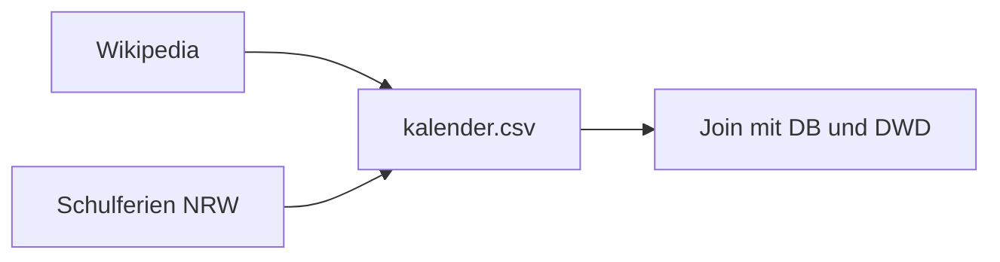

# Markdown-Spickzettel

Mein Nachschlagewerk für Markdown, angelegt für Lab 1, Task 3. Jeder Eintrag sagt, ob er im Standard **CommonMark** funktioniert (getestet im [CommonMark Dingus](https://spec.commonmark.org/dingus/) und auf GitHub) oder nur auf **GitHub**. Darunter stehen der Quelltext und das Ergebnis.

## Inhalt

- [Text](#text)
  - [Überschriften](#überschriften)
  - [Absätze und Zeilenumbrüche](#absätze-und-zeilenumbrüche)
  - [Kursiv, fett und beides](#kursiv-fett-und-beides)
  - [Durchgestrichen](#durchgestrichen)
  - [Inline-Code](#inline-code)
  - [Ein Zeichen escapen](#ein-zeichen-escapen)
- [Listen](#listen)
  - [Ungeordnete, geordnete und verschachtelte Listen](#ungeordnete-geordnete-und-verschachtelte-listen)
  - [Aufgabenlisten](#aufgabenlisten)
- [Links und Bilder](#links-und-bilder)
  - [Inline- und Referenz-Links](#inline--und-referenz-links)
  - [Relativer Link auf eine Datei im Repo](#relativer-link-auf-eine-datei-im-repo)
  - [Link auf einen Abschnitt](#link-auf-einen-abschnitt)
  - [Bild mit Alternativtext](#bild-mit-alternativtext)
  - [Bild als Link](#bild-als-link)
- [Code](#code)
  - [Codeblöcke mit Syntax-Highlighting](#codeblöcke-mit-syntax-highlighting)
- [Zitate](#zitate)
  - [Zitate, verschachtelt und formatiert](#zitate-verschachtelt-und-formatiert)
  - [Alerts](#alerts)
- [Tabellen](#tabellen)
  - [Tabelle mit ausgerichteten Spalten, Link und `|` in einer Zelle](#tabelle-mit-ausgerichteten-spalten-link-und--in-einer-zelle)
- [Layout](#layout)
  - [Horizontale Linie](#horizontale-linie)
  - [Eingeklappte Abschnitte](#eingeklappte-abschnitte)
  - [Kommentare, die nicht angezeigt werden](#kommentare-die-nicht-angezeigt-werden)
- [GitHub-Extras](#github-extras)
  - [Fußnoten](#fußnoten)
  - [Emoji-Shortcodes](#emoji-shortcodes)
  - [@Mentions und Verweise auf Issues](#mentions-und-verweise-auf-issues)
  - [Mermaid-Diagramm](#mermaid-diagramm)
  - [Formeln](#formeln)
- [Pitfalls](#pitfalls)

## Text

### Überschriften

**CommonMark** · Eine bis sechs `#` am Zeilenanfang, danach ein Leerzeichen. Im Beispiel nehme ich Ebene 5 und 6, damit das Inhaltsverzeichnis nicht durcheinanderkommt.

```markdown
##### Überschrift Ebene 5
###### Überschrift Ebene 6
```

##### Überschrift Ebene 5
###### Überschrift Ebene 6

### Absätze und Zeilenumbrüche

**CommonMark** · Eine Leerzeile trennt Absätze. Ein einfacher Zeilenumbruch wird zu einem Leerzeichen. Einen echten Umbruch erzwingt ein `\` oder zwei Leerzeichen am Zeilenende.

```markdown
Erste Zeile
läuft einfach weiter.

Neuer Absatz mit Umbruch\
direkt danach.
```

Erste Zeile
läuft einfach weiter.

Neuer Absatz mit Umbruch\
direkt danach.

### Kursiv, fett und beides

**CommonMark** · Ein Stern macht kursiv, zwei fett, drei beides. Unterstriche gehen auch, aber nicht mitten im Wort.

```markdown
*kursiv*, **fett** und ***beides***, auch _so_ und __so__.
```

*kursiv*, **fett** und ***beides***, auch _so_ und __so__.

### Durchgestrichen

**GitHub** · Zwei Tilden auf jeder Seite streichen Text durch. Das gehört nicht zum CommonMark-Standard, im Dingus bleiben die Tilden stehen.

```markdown
~~Gesetzliche Feiertage in Deutschland~~ Feiertag (Deutschland)
```

~~Gesetzliche Feiertage in Deutschland~~ Feiertag (Deutschland)

### Inline-Code

**CommonMark** · Backticks markieren Code im Fließtext. Enthält der Code selbst einen Backtick, nimmt man zwei außen herum.

```markdown
Die Spalte `ist_feiertag_nrw` ist ein Boolean, und ``a `b` c`` zeigt Backticks.
```

Die Spalte `ist_feiertag_nrw` ist ein Boolean, und ``a `b` c`` zeigt Backticks.

### Ein Zeichen escapen

**CommonMark** · Ein Backslash vor einem Sonderzeichen wie `*` zeigt das Zeichen selbst an, statt zu formatieren.

```markdown
\*kein kursiv\* und 5 \* 3

\# keine Überschrift
```

\*kein kursiv\* und 5 \* 3

\# keine Überschrift

[↑ nach oben](#inhalt)

## Listen

### Ungeordnete, geordnete und verschachtelte Listen

**CommonMark** · `-`, `*` oder `+` für ungeordnete, `1.` für geordnete Listen. Zum Verschachteln rückt man so weit ein, dass der Text unter dem Text des Elternpunkts steht.

```markdown
1. Rohdaten holen
2. Aufbereiten
   - Datum nach ISO 8601
   - UTC nach Europe/Berlin
3. Joinen
```

1. Rohdaten holen
2. Aufbereiten
   - Datum nach ISO 8601
   - UTC nach Europe/Berlin
3. Joinen

### Aufgabenlisten

**GitHub** · `- [ ]` und `- [x]` werden auf GitHub zu Kästchen. CommonMark kennt sie nicht und zeigt die Klammern als Text.

```markdown
- [x] Datensatz profilieren
- [ ] Zeile im Team-README ergänzen
```

- [x] Datensatz profilieren
- [ ] Zeile im Team-README ergänzen

[↑ nach oben](#inhalt)

## Links und Bilder

### Inline- und Referenz-Links

**CommonMark** · Inline steht die URL direkt in Klammern hinter dem Text. Bei Referenz-Links steht sie einmal weiter unten und wird über einen Namen eingebunden.

```markdown
Die Daten kommen aus der [Wikipedia](https://de.wikipedia.org/wiki/Feiertag_(Deutschland)) und vom [Schulministerium][msb].

[msb]: https://www.schulministerium.nrw.de/ "Ministerium für Schule und Bildung NRW"
```

Die Daten kommen aus der [Wikipedia](https://de.wikipedia.org/wiki/Feiertag_(Deutschland)) und vom [Schulministerium][msb].

[msb]: https://www.schulministerium.nrw.de/ "Ministerium für Schule und Bildung NRW"

### Relativer Link auf eine Datei im Repo

**CommonMark** · Ein Pfad statt einer URL verlinkt eine Datei im selben Repository, ausgehend vom Ordner der aktuellen Datei. Die Syntax ist Standard, dass der Link auf GitHub zur Datei führt, liegt am Repo.

```markdown
Mein Profil steht in [dataset.md](dataset.md), das Repo-README [eine Ebene höher](../../README.md).
```

Mein Profil steht in [dataset.md](dataset.md), das Repo-README [eine Ebene höher](../../README.md).

### Link auf einen Abschnitt

**GitHub** · GitHub gibt jeder Überschrift einen Anker: klein geschrieben, Leerzeichen werden zu `-`, Satzzeichen fallen weg, Umlaute bleiben. CommonMark erzeugt keine Anker, der Link führt im Dingus also ins Leere.

```markdown
Siehe [Pitfalls](#pitfalls) und [Kursiv, fett und beides](#kursiv-fett-und-beides).
```

Siehe [Pitfalls](#pitfalls) und [Kursiv, fett und beides](#kursiv-fett-und-beides).

### Bild mit Alternativtext

**CommonMark** · Wie ein Link, nur mit `!` davor. Der Text in eckigen Klammern ist der Alternativtext für Screenreader und falls das Bild fehlt.

```markdown

```


### Bild als Link

**CommonMark** · Man setzt das komplette Bild als Text in einen Link.

```markdown
[](https://de.wikipedia.org/wiki/Erster_Mai)
```

[](https://de.wikipedia.org/wiki/Erster_Mai)

[↑ nach oben](#inhalt)

## Code

### Codeblöcke mit Syntax-Highlighting

**CommonMark** · Drei Backticks öffnen und schließen einen Block, das Wort dahinter (*info string*) nennt die Sprache. Der Block selbst ist CommonMark, die Farben macht erst GitHub. Im Dingus bekommt der Block nur die Klasse `language-python`.

````markdown
```python
import pandas as pd
kal = pd.read_csv("kalender.csv", parse_dates=["datum"])
```

```bash
curl -fL -o data/raw/schulferien.csv "$url"
```

```json
{"datum": "2025-05-01", "ist_feiertag_nrw": true}
```
````

```python
import pandas as pd
kal = pd.read_csv("kalender.csv", parse_dates=["datum"])
```

```bash
curl -fL -o data/raw/schulferien.csv "$url"
```

```json
{"datum": "2025-05-01", "ist_feiertag_nrw": true}
```

[↑ nach oben](#inhalt)

## Zitate

### Zitate, verschachtelt und formatiert

**CommonMark** · `>` macht ein Zitat, `>>` ein Zitat im Zitat. Darin funktioniert normale Formatierung.

```markdown
> Laut Lab 1:
> **Your dataset profile is the first section of your roadmap.**
>
>> Und darin ein *verschachteltes* Zitat mit `Code`.
```

> Laut Lab 1:
> **Your dataset profile is the first section of your roadmap.**
>
>> Und darin ein *verschachteltes* Zitat mit `Code`.

### Alerts

**GitHub** · Ein Zitat, das mit `[!NOTE]`, `[!TIP]`, `[!IMPORTANT]`, `[!WARNING]` oder `[!CAUTION]` beginnt, wird auf GitHub zu einem farbigen Kasten. Im Dingus bleibt es ein normales Zitat mit dem Text `[!NOTE]`.

```markdown
> [!NOTE]
> Karneval ist in NRW kein gesetzlicher Feiertag.

> [!WARNING]
> Der DWD liefert UTC, vor dem Join umrechnen.
```

> [!NOTE]
> Karneval ist in NRW kein gesetzlicher Feiertag.

> [!WARNING]
> Der DWD liefert UTC, vor dem Join umrechnen.

[↑ nach oben](#inhalt)

## Tabellen

### Tabelle mit ausgerichteten Spalten, Link und `|` in einer Zelle

**GitHub** · Tabellen gibt es nur in GitHub Flavored Markdown. Doppelpunkte in der Trennzeile richten die Spalten aus. Ein `|` in einer Zelle muss man mit `\|` escapen, sonst beginnt eine neue Spalte.

```markdown
| Feiertag | Datum | Länder |
| :--- | :---: | ---: |
| [Erster Mai](https://de.wikipedia.org/wiki/Erster_Mai) | 2025-05-01 | 16 |
| Fronleichnam | 2025-06-19 | 6 |
| `a \| b` | links \| rechts | 0 |
```

| Feiertag | Datum | Länder |
| :--- | :---: | ---: |
| [Erster Mai](https://de.wikipedia.org/wiki/Erster_Mai) | 2025-05-01 | 16 |
| Fronleichnam | 2025-06-19 | 6 |
| `a \| b` | links \| rechts | 0 |

[↑ nach oben](#inhalt)

## Layout

### Horizontale Linie

**CommonMark** · Drei oder mehr `-`, `*` oder `_` allein in einer Zeile. Vorsicht: `---` direkt unter einer Textzeile macht daraus eine Überschrift, deshalb eine Leerzeile davor.

```markdown
Oben

---

Unten
```

Oben

---

Unten

### Eingeklappte Abschnitte

**CommonMark** · Das HTML-Element `<details>` mit `<summary>`. CommonMark erlaubt HTML-Blöcke, deshalb klappt es auch im Dingus. Markdown im Inneren funktioniert nur mit einer Leerzeile nach `</summary>`.

```markdown
<details>
<summary>Hinweis: Warum fehlt 2024?</summary>

Die Tabelle der beweglichen Feiertage beginnt erst **2025**.

</details>
```

<details>
<summary>Hinweis: Warum fehlt 2024?</summary>

Die Tabelle der beweglichen Feiertage beginnt erst **2025**.

</details>

### Kommentare, die nicht angezeigt werden

**CommonMark** · Ein HTML-Kommentar steht im Quelltext, wird aber nicht angezeigt. Gut für Notizen an mich selbst. Im Ergebnis unten sieht man deshalb nur den Satz.

```markdown
Dieser Satz ist sichtbar.
<!-- TODO: Wert nach dem Veröffentlichen prüfen -->
```

Dieser Satz ist sichtbar.
<!-- TODO: Wert nach dem Veröffentlichen prüfen -->

[↑ nach oben](#inhalt)

## GitHub-Extras

### Fußnoten

**GitHub** · `[^1]` im Text und die Definition `[^1]: …` irgendwo im Dokument. GitHub setzt die Fußnoten ganz unten auf die Seite, deshalb steht die Fußnote dieses Beispiels am Ende des Spickzettels.

```markdown
Die Feiertage stammen aus Wikipedia.[^wiki]

[^wiki]: Version 271794065 vom 01.11.2026, CC BY-SA 4.0.
```

Die Feiertage stammen aus Wikipedia.[^wiki]

[^wiki]: Version 271794065 vom 01.11.2026, CC BY-SA 4.0.

### Emoji-Shortcodes

**GitHub** · Ein Name zwischen Doppelpunkten wird auf GitHub zum Emoji. Im Dingus bleibt `:train:` stehen.

```markdown
:train: bei :cloud_with_rain: = :hourglass:
```

:train: bei :cloud_with_rain: = :hourglass:

### @Mentions und Verweise auf Issues

**GitHub** · `@name` verlinkt ein GitHub-Profil, `#3` ein Issue oder einen PR im selben Repo, `owner/repo#3` eins in einem anderen Repo. Das klappt nur in Issues, PRs und Kommentaren zuverlässig. In meinem Test mit der GitHub-Markdown-API wurde `@breuert` im Kommentar-Modus verlinkt, im Datei-Modus nicht. `#1` wurde gar nicht verlinkt, weil es im Team-Repo noch kein Issue 1 gibt. In Dateien schreibe ich deshalb immer den vollen Link dazu.

```markdown
Die Labs kommen von @breuert ([Profil](https://github.com/breuert)), und in einem Issue würde dis-bahn-wetter/bahn-wetter#1 auf Issue 1 im [Team-Repo](https://github.com/dis-bahn-wetter/bahn-wetter) zeigen.
```

Die Labs kommen von @breuert ([Profil](https://github.com/breuert)), und in einem Issue würde dis-bahn-wetter/bahn-wetter#1 auf Issue 1 im [Team-Repo](https://github.com/dis-bahn-wetter/bahn-wetter) zeigen.

### Mermaid-Diagramm

**GitHub** · Ein Codeblock mit dem info string `mermaid` wird auf GitHub als Diagramm gezeichnet. Im Dingus bleibt es ein Codeblock.

````markdown

````


### Formeln

**GitHub** · LaTeX zwischen `$` steht im Text, zwischen `$$` als eigener Block. GitHub setzt es mit MathJax, im Dingus bleiben die Dollarzeichen stehen.

```markdown
Mittlere Verspätung: $\bar{x} = \frac{1}{n}\sum_{i=1}^{n} x_i$

$$
p = \frac{\text{Halte mit} \geq 6 \text{ min}}{\text{alle Halte}}
$$
```

Mittlere Verspätung: $\bar{x} = \frac{1}{n}\sum_{i=1}^{n} x_i$

$$
p = \frac{\text{Halte mit} \geq 6 \text{ min}}{\text{alle Halte}}
$$

[↑ nach oben](#inhalt)

## Pitfalls

<!-- Entwurf: Diese Punkte sind beim Testen im CommonMark-Renderer und über die GitHub-Markdown-API aufgefallen. Lennart: durch eigene Erfahrungen ergänzen oder ersetzen. -->

1. **Der Zeilenumbruch verschwindet.** Zwei Zeilen direkt untereinander landen gerendert in einer Zeile, weil Markdown einen einfachen Umbruch zu einem Leerzeichen macht. Lösung: ein `\` am Zeilenende (zwei Leerzeichen gehen auch, sieht man im Editor aber nicht).
2. **Einen Codeblock im Codeblock zeigen.** Der äußere Block endet beim ersten inneren ```` ``` ````. Lösung: außen vier Backticks (````` ```` `````), innen drei. So sind die Mermaid- und Code-Beispiele oben gebaut.
3. **Ein `|` in einer Tabelle macht eine neue Spalte auf**, auf GitHub sogar innerhalb von Backticks: Aus `` `a | b` `` wurde im Test eine Zelle mit nur `` `a ``. Lösung: `\|`.
4. **`@breuert` und `#1` werden nicht überall zu Links.** Über die GitHub-Markdown-API getestet: Im Kommentar-Modus wird `@breuert` verlinkt, im Datei-Modus (so wie GitHub `.md`-Dateien zeigt) nicht, und `#1` nirgends, solange es das Issue nicht gibt. Lösung: in Dateien den Link selbst schreiben, z. B. `[#3](https://github.com/OWNER/REPO/issues/3)`. <!-- TODO Lennart: nach dem Veröffentlichen in der Datei und in einem Issue-Kommentar gegenprüfen -->
5. **Anker mit Satzzeichen.** Aus *Kursiv, fett und beides* wird der Anker `#kursiv-fett-und-beides`: Das Komma fällt weg, Umlaute bleiben (`#überschriften`), und aus *Inline- und Referenz-Links* wird `#inline--und-referenz-links` mit zwei Bindestrichen. Lösung: auf GitHub über die Überschrift fahren und den Link vom Kettensymbol kopieren.
