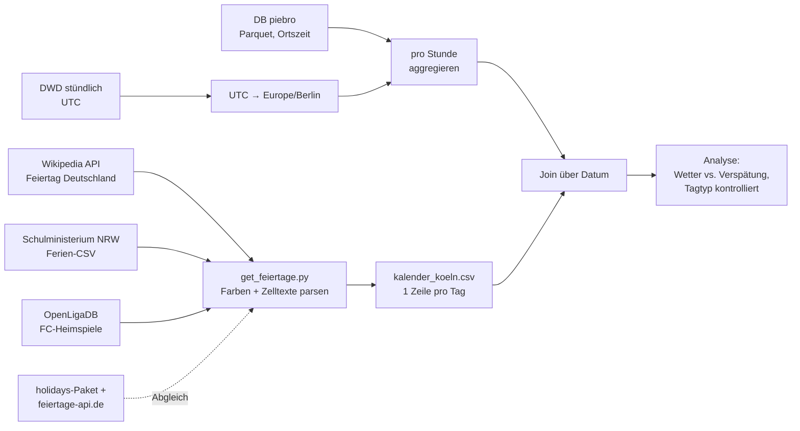

# Datensatz-Profil: Feiertage & Events für Köln/NRW

| | Wikipedia: Gesetzliche Feiertage in Deutschland |
| --- | --- |
| Titel | *Feiertag (Deutschland)*, Tabelle „Übersicht aller gesetzlichen Feiertage“ und Tabelle „Bewegliche Feiertage“ |
| Herausgeber | Autor:innen der deutschsprachigen Wikipedia, Wikimedia Foundation. Die eigentliche Grundlage sind die Feiertagsgesetze der 16 Länder (für NRW das *Gesetz über die Sonn- und Feiertage*, FTG NW) |
| Link / Kennung | https://de.wikipedia.org/wiki/Feiertag_(Deutschland), feste Version: https://de.wikipedia.org/w/index.php?oldid=271794065 |
| Formate | HTML (Artikel), Wikitext und JSON über die [MediaWiki-API](https://de.wikipedia.org/w/api.php?action=parse&page=Feiertag_(Deutschland)&prop=text&format=json) |
| Größe | Artikel mit 75.783 Bytes Wikitext. Übersichtstabelle mit 22 Feiertagen × 16 Ländern (352 Zellen), dazu 5 Zeilen mit Summen. Bewegliche Feiertage: 9 Feiertage × 11 Jahre |
| Abdeckung | Deutschland, alle 16 Länder. Die Regeln sind nicht an Jahre gebunden, die beweglichen Termine stehen für 2025 bis 2035. Granularität: ein Feiertag pro Land |
| Letzte Änderung | 01.11.2026 05:38 (UTC), Version 271794065 |
| Aktualisierung | unregelmäßig, je nach Bearbeitung. Die letzten 10 Änderungen liegen zwischen dem 12.03. und dem 01.11.2026 |
| Lizenz | [CC BY-SA 4.0](https://creativecommons.org/licenses/by-sa/4.0/deed.de) (laut Fußzeile und `meta=siteinfo&siprop=rightsinfo` der API) |

Ich bin im Team **Bahn & Wetter** ([dis-bahn-wetter/bahn-wetter](https://github.com/dis-bahn-wetter/bahn-wetter)). Unsere Frage ist, ob die Bahn in Köln bei Regen, Sturm oder Hitze unpünktlicher ist. Tommy profiliert die DB-Verspätungen, Paul das DWD-Wetter. Ich habe die Feiertage übernommen. Sie sind für uns eher eine Kontrollvariable: An Feiertagen fahren weniger Züge und weniger Leute, und das könnte einen Wettereffekt überdecken oder vortäuschen.

Abgerufen und ausgewertet habe ich alles am **10.11.2026**. Am 12.11.2026 habe ich die wichtigsten Angaben noch einmal live nachgeprüft (Wikipedia-Version und Lizenz, Trefferzahlen von GovData und Open.NRW, Statistiken der CSVs): alles unverändert. Das Skript dazu liegt in [`feiertage/get_feiertage.py`](feiertage/get_feiertage.py).

## Task 5 · Datensatz finden

### Wo ich gesucht habe

| Quelle | Art | Suchbegriff | Ergebnis |
| --- | --- | --- | --- |
| [GovData](https://www.govdata.de) | nationales Portal | `feiertage` | 57 Treffer. Der erste ist der *Interkulturelle Kalender der Stadt Krefeld*, also nichts für NRW insgesamt |
| [GovData](https://www.govdata.de) | nationales Portal | `schulferien` | 6 Treffer. Der erste ist **Schulferien NRW** vom Ministerium für Schule und Bildung NRW, den nehme ich als Zusatzquelle (siehe unten) |
| [Open.NRW](https://open.nrw) | Landesportal | `feiertage` | 24 Treffer, ebenfalls zuerst der Krefelder Kalender |
| [Open.NRW](https://open.nrw) | Landesportal | `feiertage koeln` | 10 Treffer, fast alle *Diversity Kalender Köln* (2017 bis 2026, dl-de/zero-2-0). Das sind religiöse und kulturelle Gedenktage, keine gesetzlichen Feiertage |
| [Open.NRW](https://open.nrw) | Landesportal | `karneval` | 4 Treffer, z. B. *Glasverbotszone Düsseldorf Karneval* (Lizenz `other-closed`). Karnevalstermine für Köln gibt es dort nicht |
| [Offene Daten Köln](https://www.offenedaten-koeln.de) | Stadtportal | `feiertage` | Die CKAN-API unter `/api/3/action/package_search` gibt bei mir nur eine HTML-Seite zurück, und die Suche über die Website lieferte einen 404. Die Kölner Datensätze habe ich deshalb über Open.NRW gesucht (das Portal übernimmt sie) |
| [Zenodo](https://zenodo.org) | Repository | `"public holidays" germany` | Die ersten Treffer sind australische Feiertagslisten (New South Wales). Für Deutschland habe ich nichts Brauchbares gefunden |

Fazit: Eine offizielle, maschinenlesbare Liste der gesetzlichen Feiertage aller Bundesländer habe ich in keinem Portal gefunden. Die Feiertage selbst stehen in den Feiertagsgesetzen der Länder (für uns das [Feiertagsgesetz NW](https://recht.nrw.de/lmi/owa/br_bes_text?sg=0&menu=1&bes_id=3367&aufgehoben=N&anw_nr=2)), aber dort nur als Gesetzestext und ohne konkrete Daten für die einzelnen Jahre. Deshalb nehme ich die Übersichtstabelle auf Wikipedia, die sich auf genau diese Gesetze stützt, und gleiche sie mit zwei anderen Quellen ab.

### Suche wie eine Maschine

```text
https://www.govdata.de/ckan/api/3/action/package_search?q=feiertage&rows=1
https://open.nrw/api/3/action/package_search?q=feiertage&rows=1
```

| API | `count` | erster Treffer | wo steht die Lizenz? |
| --- | --- | --- | --- |
| GovData | 57 | Interkultureller Kalender der Stadt Krefeld | `license_id` ist leer (`""`). Die Lizenz steht nur pro Datei unter `resources` → `license`: `http://dcat-ap.de/def/licenses/dl-zero-de/2.0` |
| Open.NRW | 24 | Interkultureller Kalender der Stadt Krefeld | bei Open.NRW für den ganzen Datensatz (`license_id` = `http://dcat-ap.de/def/licenses/dl-zero-de/2.0`) **und** pro Datei |

Witzig fand ich, dass es derselbe Datensatz ist, GovData ihn von Open.NRW übernimmt und dabei die Lizenz auf Datensatzebene verliert.

### Auswahl

- **Hauptquelle:** Wikipedia-Artikel [Feiertag (Deutschland)](https://de.wikipedia.org/wiki/Feiertag_(Deutschland)), Abschnitte *Übersicht aller gesetzlichen Feiertage* und *Kalendarische Daten → Bewegliche Feiertage*. Der Link aus unserem Team-Chat, [Gesetzliche Feiertage in Deutschland](https://de.wikipedia.org/wiki/Gesetzliche_Feiertage_in_Deutschland), ist inzwischen nur noch eine Weiterleitung auf diesen Artikel. Ich arbeite mit der Version [271794065 vom 01.11.2026](https://de.wikipedia.org/w/index.php?oldid=271794065).
- **Warum:** Die Seite enthält alle 16 Bundesländer in einer Tabelle und unterscheidet *landesweit* und *regional*. Die Termine der beweglichen Feiertage stehen dort für 2025 bis 2035. Die Lizenz ist offen (CC BY-SA 4.0), und alles lässt sich über die MediaWiki-API ohne Login abrufen. Die originalen Herausgeber der Regeln sind die Landesgesetzgeber, und Wikipedia verlinkt deren Gesetze in den Einzelnachweisen.
- **Zusatzquellen** für unsere Frage (siehe Task 8): NRW-Schulferien vom Schulministerium, Heimspiele des 1. FC Köln aus OpenLigaDB und die Kölner Karnevalstage.

## Task 6 · Profil

### Fakten

Siehe die Tabelle ganz oben.

Daraus habe ich mit dem Skript diese Dateien gebaut (alle UTF-8, Trennzeichen Komma, Datum nach ISO 8601):

| Datei | Zeilen | Spalten | Inhalt |
| --- | --- | --- | --- |
| [`feiertage_de_2024-2027.csv`](feiertage/feiertage_de_2024-2027.csv) | 70 | 12 | jeder gesetzliche Feiertag in mindestens einem Land, 08.08.2024 bis 26.12.2027 |
| [`kalender_koeln_2024-07-01_2027-12-31.csv`](feiertage/kalender_koeln_2024-07-01_2027-12-31.csv) | 1.279 | 16 | **ein Eintrag pro Tag** vom 01.07.2024 bis 31.12.2027, die Tabelle für den Join |
| [`events_koeln_2024-2027.csv`](feiertage/events_koeln_2024-2027.csv) | 67 | 9 | 16 Karnevalstage und 51 FC-Heimspiele |
| [`schulferien_nrw_2024-2027.csv`](feiertage/schulferien_nrw_2024-2027.csv) | 18 | 5 | Ferienzeiträume NRW, Schuljahre 2024/25 bis 2027/28 |

Der Kalender beginnt am 01.07.2024, weil die DB-Daten von piebro mit `data-2024-07.parquet` anfangen. Die letzte DB-Datei ist im Moment `data-2026-10.parquet`. 2027 habe ich trotzdem mitgenommen, damit wir nicht neu scrapen müssen, falls neue Monate dazukommen.

### Sterne

Die Wikipedia-Tabelle bekommt formal ★★★: Sie steht unter offener Lizenz im Netz (★), ist als Tabelle strukturiert (★★) und HTML ist ein offenes Format (★★★). Ehrlich gesagt ist sie in der Praxis eher bei ★★, denn ein Teil der Bedeutung steckt in den **Hintergrundfarben** der Zellen (grün = landesweit, gelb = regional), und die Termine stehen ohne Jahr da (`17.04.`, das Jahr steht nur im Spaltenkopf). Für den vierten Stern bräuchte jeder Feiertag eine eigene URI, z. B. über Wikidata, die ich aber noch nicht angeschaut habe.

Meine eigenen CSV-Dateien sind ★★★. Dafür hätte ich auch keine Fakten zu Wikipedia nehmen müssen.

### Die Daten öffnen

Ich habe die Seite nicht im Browser abgeschrieben, sondern über die MediaWiki-API als JSON geholt und in **Python** (pandas 3.1 mit `read_html`, BeautifulSoup für die Farben) ausgewertet. Die fertigen CSVs habe ich danach mit pandas nachgeprüft.

Zahlen aus der Wikipedia-Tabelle selbst (Zeile „Gesamtzahl Feiertage, die im Großteil des Bundeslandes gelten …“):

| Spalte | Min | Max | Mittel |
| --- | --- | --- | --- |
| Feiertage pro Land insgesamt | 10 (BE, BB, HB, HH, HE, NI, SH) | 13 (BY) | 10,81 |
| davon an einem festen Datum | 5 (HE) | 8 (BY) | 6,38 |

NRW hat laut Tabelle 11 Feiertage, und genau 11 pro Jahr kommen bei mir auch heraus.

Zahlen aus meinen CSVs:

| Datei · Spalte | Min | Max | Mittel |
| --- | --- | --- | --- |
| `feiertage` · `anzahl_laender` (Länder, in denen der Tag landesweit frei ist) | 0 | 16 | 8,49 |
| `kalender` · `anzahl_laender_mit_feiertag` (pro Kalendertag) | 0 | 16 | 0,46 |

Die 0 bei `anzahl_laender` ist das Augsburger Friedensfest. Es gilt nur in der Stadt Augsburg und ist deshalb nirgends landesweit.

**Leere Zellen:** In der Übersichtstabelle sind 148 der 352 Zellen leer, das heißt der Tag ist dort kein Feiertag. Die Spalte NW hat 9 leere Zellen bei 22 Zeilen (11 × „ja“, 1 × „nur 2017“, 1 × „bis 1994“). In meiner `feiertage`-CSV ist `laender_teilweise` 59-mal leer. Das ist richtig so, denn nur 11 Termine gelten in einem Land bloß regional. `laender_landesweit` ist viermal leer, nämlich bei den vier Friedensfesten.

Was mir aufgefallen ist:

- **Bedeutung steckt in Farben.** Ob „ja“ landesweit oder regional ist, sieht man nur an der CSS-Klasse (`hintergrundfarbe9` vs. `hintergrundfarbe8`). Mit `pd.read_html` allein geht diese Information verloren, deshalb lese ich die Klassen mit BeautifulSoup aus.
- **Uneinheitliche Zelltexte:** `ja`, `ja[A 7]`, `seit 2019`, `nur 2020/2025`, `bis 1994` und `bis1994` (ohne Leerzeichen), `2017[A 1]`. Laut Versionsgeschichte wurde am 01.06.2026 noch ein „falsches Ja“ korrigiert und `Ja` → `ja` vereinheitlicht. Mein Parser ignoriert deshalb die Groß- und Kleinschreibung.
- **Nur schulfrei:** Gründonnerstag ist in BW nur schulfrei und hat keine Farbe, nur eine Fußnote. Das zähle ich nicht als Feiertag.
- **Geschütztes Leerzeichen:** In der Tabelle der beweglichen Feiertage steht `Christi Himmelfahrt` mit einem `&nbsp;`. Dadurch hat mein Skript den Namen erst nicht gefunden und das Datum selbst berechnet. Das ist mir nur aufgefallen, weil ich mitzähle, welche Daten berechnet sind.
- **Die Kopfzeile wiederholt sich** am Tabellenende, darunter steht eine Legendenzeile. Beide muss man überspringen.
- **Kein 2024:** Die Tabelle der beweglichen Feiertage beginnt bei 2025. Für 2024 berechne ich die Termine selbst. Im zweiten Halbjahr 2024 betrifft das nur den Buß- und Bettag in Sachsen (20.11.2024). Die Osterformel stimmt für alle 2025 bis 2035 eingetragenen Werte mit Wikipedia überein (0 Abweichungen).

### Datenwörterbuch

Wikipedia dokumentiert die Tabelle nur über die Legende (Farben) und die Anmerkungen [A 1] bis [A 24]. Ein richtiges Datenwörterbuch gibt es nicht. Deshalb beschreibe ich hier die Spalten meiner Kalendertabelle, mit der wir später joinen:

| Spalte | Bedeutung | Typ / Einheit | Beispiel |
| --- | --- | --- | --- |
| `datum` | Kalendertag, Join-Schlüssel | Datum, ISO 8601, deutsche Ortszeit | `2025-05-01` |
| `wochentag` | Wochentag | Text, `Mo` bis `So` | `Do` |
| `ist_feiertag_nrw` | gesetzlicher Feiertag in NRW | boolean | `True` |
| `feiertag_nrw` | Name des NRW-Feiertags, sonst leer | Text | `Erster Mai, Tag der Arbeit` |
| `anzahl_laender_mit_feiertag` | in wie vielen Ländern der Tag landesweit frei ist (wichtig für den Fernverkehr, der durch Köln fährt) | Ganzzahl, 0 bis 16 | `16` |
| `ist_feiertag_bundesweit` | `anzahl_laender_mit_feiertag == 16` | boolean | `True` |
| `tagtyp` | `Werktag`, `Samstag` oder `Sonn-/Feiertag` (NRW-Feiertage zählen wie Sonntage) | Kategorie | `Sonn-/Feiertag` |
| `ist_brueckentag_nrw` | Werktag zwischen einem NRW-Feiertag und dem Wochenende | boolean | `True` am `2025-05-02` |
| `ist_schulferien_nrw` / `schulferien_nrw` | Tag liegt in NRW-Schulferien / Name der Ferien | boolean / Text | `True` / `Osterferien` |
| `ist_karneval_koeln` / `karneval_koeln` | Kölner Karnevalstag (kein Feiertag) | boolean / Text | `True` / `Rosenmontag` |
| `ist_fc_heimspiel` / `fc_anstoss` / `fc_gegner` | Heimspiel des 1. FC Köln im RheinEnergieStadion | boolean / Uhrzeit Ortszeit / Text | `True` / `15:30` / `FC St. Pauli` |

Die Tabelle `feiertage_de_2024-2027.csv` hat zusätzlich `geltung` (`bundesweit`/`regional`), `laender_landesweit` und `laender_teilweise` (Kürzel mit `;` getrennt, z. B. `BW;BY;HE;NW;RP;SL`), `is_nrw`, `typ` (`fest`/`beweglich`), `datum_quelle` (`wikipedia` oder `berechnet`) und `wiki_revid`, damit man sieht, aus welcher Wikipedia-Version eine Zeile stammt.

### Lizenz

Ja, die Quelle ist offen im Sinn der Open Definition: CC BY-SA steht auf der Liste der konformen Lizenzen. Für die Nachnutzung heißt das:

- **BY:** Wir müssen Titel, Autor:innen, Quelle und Lizenz nennen und angeben, dass wir die Daten verändert haben.
- **SA (Share-Alike):** Wenn wir eine *bearbeitete* Fassung der Tabelle veröffentlichen, muss sie wieder unter CC BY-SA 4.0 (oder einer kompatiblen Lizenz) stehen. Für unser Repo heißt das: Der Code kann unter MIT bleiben, aber die Feiertags-CSV, die wir aus Wikipedia ableiten, sollte im README ausdrücklich als CC BY-SA 4.0 gekennzeichnet werden. Unser übriger Datensatz darf nicht einfach unter CC BY 4.0 laufen, solange diese Spalten darin stecken.
- Kleiner Vorbehalt: Ein einzelnes Feiertagsdatum ist eigentlich ein Fakt aus einem Gesetz, und Gesetze sind als amtliche Werke gemeinfrei (§ 5 UrhG). Geschützt ist eher die Zusammenstellung der Tabelle. Sicher bin ich mir da nicht, deshalb gehe ich lieber vom strengeren Fall aus und behandle die CSV als CC BY-SA.

Namensnennung für unser README (TASL):

> *Feiertag (Deutschland)*, Version 271794065 vom 01.11.2026, von den Autor:innen der deutschsprachigen Wikipedia ([Versionsgeschichte](https://de.wikipedia.org/w/index.php?title=Feiertag_(Deutschland)&action=history)), https://de.wikipedia.org/w/index.php?oldid=271794065, lizenziert unter [CC BY-SA 4.0](https://creativecommons.org/licenses/by-sa/4.0/deed.de). Von uns ausgelesen, auf NRW gefiltert und in eine Tabelle mit einem Eintrag pro Tag umgewandelt.

Die Zusatzquellen nenne ich in Task 8.

### Personen

Die Daten enthalten keine personenbezogenen Daten, nur Kalendertage und Regeln. Die Versionsgeschichte von Wikipedia enthält zwar Benutzernamen, die übernehme ich aber nicht. Ich verlinke nur auf die Versionsgeschichte, weil das für die Namensnennung reicht.

## Task 7 · FAIR-Check

| Prinzip | Bewertung | Beleg |
| --- | --- | --- |
| F1 | ~ | Stabile URL und zusätzlich ein Permalink auf jede einzelne Version (`?oldid=271794065`), aber kein DOI. Der alte Titel *Gesetzliche Feiertage in Deutschland* leitet nur noch weiter, Links können also umziehen |
| F2 | ~ | Titel, Datum der letzten Änderung und Kategorien sind vorhanden, eine Beschreibung der *Tabelle* als Datensatz (Spalten, Methode) fehlt aber |
| F4 | ~ | Über jede Suchmaschine sofort zu finden, aber nicht in GovData, Open.NRW oder Zenodo |
| A1 | ✓ | HTTPS ohne Login, dazu eine dokumentierte API (`/w/api.php?action=parse`). Wikimedia möchte einen aussagekräftigen User-Agent, den setze ich im Skript |
| I1 | ~ | HTML und Wikitext sind offen, aber eine Tabelle in einem Fließtextartikel ist kein Datenformat. Ohne die CSS-Klassen geht die Hälfte der Bedeutung verloren |
| I2, I3 | ~ | Länder als Kürzel (`NW`), fast wie ISO 3166-2 (`DE-NW`), aber ohne Präfix. Daten als `1. Januar` oder `17.04.` ohne Jahr, also kein ISO 8601. Gut: Die Einzelnachweise verlinken die Feiertagsgesetze, z. B. das [FTG NW](https://recht.nrw.de/lmi/owa/br_bes_text?sg=0&menu=1&bes_id=3367&aufgehoben=N&anw_nr=2) |
| R1 | ~ | Legende und Anmerkungen erklären einiges, es gibt aber kein Datenwörterbuch |
| R1.1 | ✓ | Die Lizenz ist klar und maschinenlesbar über die API (`meta=siteinfo&siprop=rightsinfo` → `Creative Commons Attribution-Share Alike 4.0`) |
| R1.2 | ~ | Jede Änderung ist mit Zeit und Account in der Versionsgeschichte nachvollziehbar. Es ist aber eine Sekundärquelle. Der Einzelnachweis für NW wurde zuletzt am 19.04.2019 abgerufen |
| R1.3 | ✗ | Keine DCAT-AP-Metadaten, der Artikel taucht in keinem Datenportal auf |

**Fazit:** Die Quelle ist eindeutig **offen** (CC BY-SA, freier Zugriff, API), aber nur **teilweise FAIR**. Sie ist leicht zu finden und abzurufen, aber schwer maschinell wiederzuverwenden, weil sie für Menschen und nicht für Programme gemacht ist. Positiv überrascht hat mich die Versionsgeschichte, denn damit kann man genau festhalten, mit welchem Stand man gearbeitet hat.

Was ich für unseren eigenen Datensatz (Meilenstein 2) besser machen will:

1. Datum immer als ISO 8601 mit Jahr und dazu schreiben, welche Zeitzone gemeint ist (bei uns `Europe/Berlin`).
2. Bedeutung nie nur über Formatierung transportieren, sondern als eigene Spalte (`geltung`, `ist_…`) und mit einem Datenwörterbuch im Repo.
3. In jeder Zeile festhalten, woher sie stammt (`datum_quelle`, `wiki_revid`), und die Lizenz maschinenlesbar mitliefern, z. B. als `datapackage.json`.

## Task 8 · Womit ich es kombiniere

### Zweite Quelle

Die wichtigste zweite Quelle ist für uns die **DB-Verspätung**: [piebro/deutsche-bahn-data](https://huggingface.co/datasets/piebro/deutsche-bahn-data), CC BY 4.0, ein Eintrag pro Halt mit `time`, `delay_in_min` und Ausfällen, monatliche Parquet-Dateien von 07/2024 bis 10/2026. Tommy profiliert sie ausführlich. Für die Feiertage selbst habe ich außerdem noch diese Quellen eingebaut oder zum Abgleich benutzt:

| Quelle | wofür | Lizenz |
| --- | --- | --- |
| [Schulferien NRW](https://www.govdata.de/suche/daten/schulferien-nrw55d5d), Ministerium für Schule und Bildung NRW ([CSV](https://www.schulministerium.nrw.de/BiPo/OpenData/Schuldaten/Schulferien/OpenData_Ferientermine.csv)) | Ferienspalten im Kalender | Datenlizenz Deutschland – Namensnennung – 2.0 |
| [OpenHolidays API](https://openholidaysapi.org) | nur Abgleich der Schulferien | ODbL 1.0 |
| [OpenLigaDB](https://www.openligadb.de) | Heimspiele 1. FC Köln (2. Liga 2024/25, Bundesliga 2025/26 und 2026/27) | ODbL 1.0 ([Lizenz](https://www.openligadb.de/lizenz)) |
| Python-Paket [`holidays`](https://github.com/vacanza/holidays) 0.108 und [feiertage-api.de](https://feiertage-api.de) | nur Abgleich der Feiertage | MIT bzw. nicht angegeben (ich veröffentliche nichts daraus) |

### Gemeinsamer Schlüssel

Der Schlüssel ist das **Datum**. Den Ort brauchen wir nicht als Schlüssel, weil alles auf Köln/NRW gefiltert ist. Echte Werte aus den Quellen:

| Quelle | wie veröffentlicht | nach der Aufbereitung |
| --- | --- | --- |
| Wikipedia, Übersicht | `1. Mai – Erster Mai, Tag der Arbeit` (ohne Jahr) | `2025-05-01` |
| Wikipedia, bewegliche Feiertage | Zeile `Christi Himmelfahrt`, Spalte `2025`: `29.05.` | `2025-05-29` |
| Schulministerium NRW | `ErsterTagDate` = `"14.04.2025"`, `ErsterTagSort` = `"20250414"` | `2025-04-14` (bis `2025-04-26` als einzelne Tage) |
| DB (piebro), `data-2025-05.parquet` | `time` = `2025-05-01 00:00:00` (Ortszeit) | `2025-05-01` |
| DWD (Pauls Profil) | `MESS_DATUM` = `2025050800` (UTC) | erst nach `Europe/Berlin` umrechnen (→ 02:00), dann `2025-05-08` |

So wie veröffentlicht passen die Schlüssel nicht zusammen. Wikipedia hat kein Jahr, das Schulministerium schreibt deutsche Daten in Anführungszeichen, und der DWD arbeitet in UTC. Nach der Umwandlung in ISO-Daten in deutscher Ortszeit passt es. Ein Punkt ist wichtig: **Der DWD muss vor dem Join auf Ortszeit umgerechnet werden.** Sonst landen die Stunden zwischen 22 und 24 Uhr (im Sommer) bzw. 23 und 24 Uhr (im Winter) auf dem falschen Tag, und an Silvester und Neujahr wäre das ausgerechnet ein Feiertag.

### Granularität

- Feiertage: ein Eintrag pro **Tag**.
- DB: ein Eintrag pro **Halt**, mit Zeitstempel auf die Minute.
- DWD: ein Eintrag pro **Stunde**, in UTC.

Mein Vorschlag: Wir rechnen DB und DWD auf Stunden in Ortszeit herunter, joinen die beiden über Datum und Stunde und hängen meine Tagesspalten dann über `datum` an. Jede Stunde eines Feiertags erbt so `ist_feiertag_nrw = True`. Wenn wir am Ende nur Tageswerte vergleichen, geht es auch direkt über `datum`.

### Kurzer Test, ob der Join klappt

Ich habe zwei DB-Monate heruntergeladen (`data-2025-05.parquet`, `data-2026-02.parquet`), auf `station_name == "Köln Hbf"` gefiltert, pro Tag zusammengefasst und mit meinem Kalender gejoint. Alle 59 Tage haben einen Treffer gefunden (`validate="one_to_one"`, keine Lücke). Die Donnerstage im Mai 2025:

| Datum | Tag | Halte | mittlere Verspätung (min) | Anteil ≥ 6 min |
| --- | --- | --- | --- | --- |
| 2025-05-01 | **Tag der Arbeit** | 1.078 | 5,94 | 23,4 % |
| 2025-05-08 | normal | 925 | 8,68 | 39,0 % |
| 2025-05-15 | normal | 921 | 6,76 | 31,8 % |
| 2025-05-22 | normal | 1.229 | 6,78 | 30,8 % |
| 2025-05-29 | **Christi Himmelfahrt** | 1.096 | 5,97 | 22,4 % |

Die beiden Feiertage sind die pünktlichsten Donnerstage des Monats. Genau deshalb brauchen wir die Spalte, sonst würden wir das vielleicht dem Wetter zuschreiben. Ein einzelner Monat beweist aber natürlich noch nichts. Merkwürdig ist, dass die Zahl der Halte ab Mitte Mai von etwa 920 auf über 1.200 springt. Das sieht für mich eher nach einer Änderung bei der Erfassung aus als nach mehr Zügen, und das muss ich mit Tommy klären. Im Februar 2026 war Weiberfastnacht (12.02.) mit 12,3 min im Schnitt einer der schlechtesten Tage, der Donnerstag davor (05.02.) war mit 13,9 min aber noch schlechter. Ohne das Wetter dazu kann man daraus also nichts ablesen.

### Forschungsfragen (nur mit beiden Quellen beantwortbar)

1. Bleibt der Zusammenhang zwischen Regen und Verspätung in Köln Hbf bestehen, wenn man Feiertage, Brückentage und Schulferien herausrechnet oder nur gleiche Tagtypen vergleicht?
2. Sind Züge an Kölner Großereignistagen (Weiberfastnacht, Rosenmontag, 11.11., FC-Heimspiele) unpünktlicher, und kommt bei schlechtem Wetter an solchen Tagen noch etwas dazu?
3. Wirkt sich ein Feiertag nur in *anderen* Bundesländern (z. B. Reformationstag am 31.10., `anzahl_laender_mit_feiertag` = 9, aber in NRW ein Werktag) auf die Pünktlichkeit in Köln aus, z. B. über den Fernverkehr?

### Lizenzen beim Kombinieren

- DB (CC BY 4.0) und DWD (CC BY 4.0) lassen sich problemlos zusammen veröffentlichen, wenn wir beide nennen.
- Sobald die Wikipedia-Feiertagsspalten drin sind, wird es CC BY-SA 4.0. CC BY-Daten dürfen in ein CC BY-SA-Werk, umgekehrt geht es nicht. Der kombinierte Datensatz sollte also **CC BY-SA 4.0** sein, mit Nennung von DB/piebro, DWD und Wikipedia.
- Schulferien (dl-de/by-2-0): Wir müssen das Ministerium, die Lizenz und den Link nennen und angeben, dass wir die Daten verändert haben. Mit CC BY-SA sollte das vereinbar sein, weil dl-de/by nur Namensnennung verlangt.
- **Offene Frage:** Die FC-Spiele kommen aus OpenLigaDB unter **ODbL**, die selbst Share-Alike ist. ODbL und CC BY-SA in *einer* Datenbank zu mischen ist laut allem, was ich gelesen habe, nicht sauber geregelt. Die FC-Spalten würde ich deshalb in einer eigenen Datei lassen (`events_koeln_…csv`, ODbL) oder im Team besprechen, ob wir sie überhaupt brauchen.

Namensnennungen der Zusatzquellen:

> *Deutsche Bahn Data*, piebro, https://huggingface.co/datasets/piebro/deutsche-bahn-data, lizenziert unter [CC BY 4.0](https://creativecommons.org/licenses/by/4.0/). (Profil und Aufbereitung: Tommy.)
>

> *Schulferien NRW*, Ministerium für Schule und Bildung des Landes Nordrhein-Westfalen, https://www.govdata.de/suche/daten/schulferien-nrw55d5d, [Datenlizenz Deutschland – Namensnennung – 2.0](https://www.govdata.de/dl-de/by-2-0). Gefiltert auf 2024 bis 2027 und in Tageswerte umgewandelt.
>
> Spieldaten 1. FC Köln, [OpenLigaDB](https://www.openligadb.de), lizenziert unter [ODbL 1.0](https://opendatacommons.org/licenses/odbl/1-0/). Auf Heimspiele gefiltert.

### Nächste Schritte



1. Rohdaten mit `python3 get_feiertage.py` holen (landen in `raw/`, nicht ins Repo).
2. Abgleich prüfen: Das Skript gibt jede Abweichung zu `holidays` und feiertage-api.de aus.
3. DWD von UTC auf `Europe/Berlin` umrechnen und DB und DWD auf Stunden bringen (das sind Pauls und Tommys Teile).
4. Kalender über `datum` anhängen und fehlende Treffer zählen (müssen 0 sein).
5. Lizenz und Namensnennungen ins README, die Feiertags-CSV als CC BY-SA kennzeichnen.

### Fazit

Ja, ich würde die Feiertage auf jeden Fall in unser Projekt aufnehmen. Sie sind klein, sauber und schnell gebaut, und schon der kurze Test im Mai 2025 zeigt, dass Feiertage die Pünktlichkeit spürbar verändern. Das größte Risiko ist nicht die Feiertagsliste selbst (drei Quellen stimmen für NRW zu 100 % überein), sondern die Lizenzfrage beim Mischen von CC BY-SA und ODbL und dass sich die Wikipedia-Tabelle jederzeit ändern kann. Deshalb speichere ich die Versions-ID in jeder Zeile.

## Qualitätschecks, die ich wirklich gemacht habe

Alle Zahlen stammen aus der Ausgabe von `get_feiertage.py` vom 10.11.2026 (`run_log.txt`):

| Check | Ergebnis |
| --- | --- |
| NRW-Feiertage im Zeitraum (Wikipedia / `holidays` / feiertage-api.de) | 37 / 37 / 37, **keine Abweichung** |
| alle 16 Länder gegen `holidays` | gleich bis auf 6 Tage in Hessen: Wikipedia zählt Oster- und Pfingstsonntag (2025 bis 2027) als Feiertag, das Paket nicht. Wikipedia führt beide für HE mit Anmerkung A 7 als Feiertag. Für NRW spielt das keine Rolle |
| bewegliche Feiertage, Wikipedia-Tabelle gegen Osterformel | 0 Abweichungen (2025 bis 2035) |
| Daten, die ich selbst berechnet habe, weil Wikipedia sie nicht hat | 1 (Buß- und Bettag 2024, nur Sachsen) |
| Duplikate (`datum` + `name`) | 0 |
| Kalender: Lücken / doppelte Tage | 0 / 0 (1.279 Tage = 01.07.2024 bis 31.12.2027) |
| NRW-Feiertage am Wochenende | 8 von 37, z. B. 03.10.2026 (Sa) und 01.11.2026 (So). Die zählen im Kalender trotzdem als Feiertag, verändern den Fahrplan aber kaum |
| Brückentage NRW | 10, alle an Freitagen (z. B. 02.05.2025, 15.05.2026) |
| Schulferien: Schulministerium gegen OpenHolidays | 18 Zeiträume, identisch. Außerhalb unseres Zeitraums steht beim Ministerium für Ostern 2023 aber `03.03.2023` als erster Tag, OpenHolidays sagt `2023-04-03`. Das ist wohl ein Tippfehler in der offiziellen Datei |
| Ferien-CSV technisch | erste Zeile `sep=;` (ein Hinweis für Excel) und ein Semikolon am Zeilenende. pandas hat dadurch die erste Spalte zum Index gemacht, und alle Spalten waren um eins verschoben, bis ich `skiprows=1, index_col=False` gesetzt habe |
| FC-Heimspiele | 51 (je 17 pro Saison). 12 davon sind noch nicht gespielt (ab 28.11.2026). Bei denen steht oft der Platzhalter 15:30, die Anstoßzeit kann sich also noch ändern |

Für den DB-Zeitraum (01.07.2024 bis 31.10.2026, 853 Tage) heißt das: 23 NRW-Feiertage, 8 Brückentage, 232 Schulferientage, 10 Karnevalstage und 38 FC-Heimspieltage.

## Grenzen

- **Regionale Feiertage:** Für NRW gibt es keine regionalen Feiertage, für andere Länder schon (z. B. Fronleichnam nur in Teilen von Sachsen und Thüringen, Mariä Himmelfahrt nur in Teilen Bayerns). Die stehen bei mir nur in `laender_teilweise` und zählen nicht in `anzahl_laender`.
- **Karneval ist kein Feiertag.** Weiberfastnacht, Karnevalssonntag, Rosenmontag, Veilchendienstag und der 11.11. sind in Köln für viele faktisch frei, gesetzlich sind es aber normale Werktage. Deshalb stehen sie in eigenen Spalten und nicht in `ist_feiertag_nrw`. Die Termine habe ich vom Aschermittwoch abgeleitet (Wikipedia-Tabelle, Weiberfastnacht = Aschermittwoch − 6 Tage, Rosenmontag = − 2).
- **Andere Events fehlen.** Für Konzerte in der LANXESS arena, Messen oder z. B. den CSD habe ich keine saubere offene Quelle gefunden, deshalb fehlen sie bewusst. Der *Diversity Kalender Köln* auf Open.NRW (dl-de/zero) wäre eine Möglichkeit für religiöse und kulturelle Tage, den habe ich mir aber noch nicht genau angesehen.
- **Bewegliche Ferientage** der einzelnen Schulen (oft an Rosenmontag) sind nicht in der Ferien-CSV.
- **Wikipedia ändert sich.** Zwischen dem 12.03. und dem 01.11.2026 gab es 10 Bearbeitungen, eine davon hat ausdrücklich ein falsches „Ja“ in der Übersicht korrigiert. Ich speichere deshalb `wiki_revid`, damit man den Stand nachvollziehen kann, und das Skript bricht bei einer Abweichung zu den Abgleichquellen nicht ab, sondern listet sie auf.
- **Zahl der Halte in den DB-Daten:** siehe der Sprung Mitte Mai 2025 oben. Das ist kein Problem meiner Daten, betrifft aber den Join-Test.

## Offene Fragen

1. Nehmen wir die FC-Heimspiele (ODbL) überhaupt in den gemeinsamen Datensatz, oder bleiben sie getrennt?
2. Wollen wir nur Köln Hbf betrachten oder auch Köln Messe/Deutz? Bei Messen und Spielen im Stadion wäre Deutz eigentlich spannender.
3. Woher kommt der Sprung bei der Zahl der Halte ab Mitte Mai 2025 (Frage an Tommy)?
4. Brauchen wir eine eigene Spalte für Silvester und Heiligabend? Beide sind keine Feiertage, aber der Verkehr ist dort sehr anders.

## Verwendete Werkzeuge

Python 3 mit pandas, requests, BeautifulSoup/lxml und `holidays` 0.108. Beim Skript und bei der Struktur dieses Profils habe ich mit einem KI-Assistenten gearbeitet, siehe `AI_USAGE.md`. Alle Zahlen in diesem Dokument kommen aus meinen eigenen Abrufen vom 10.11.2026.
